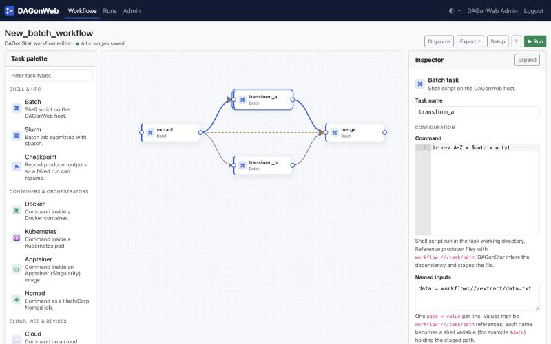
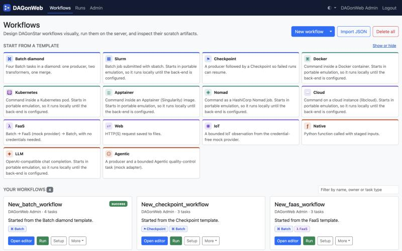
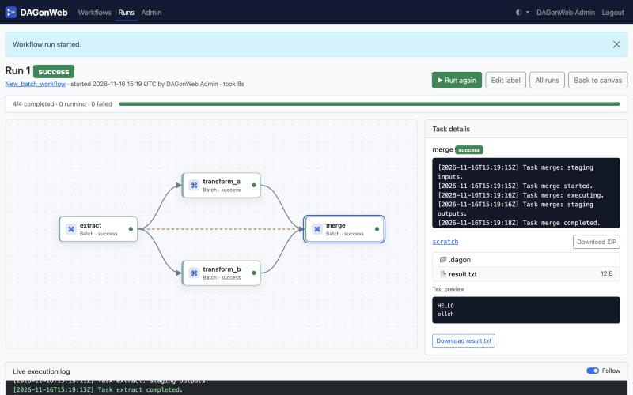
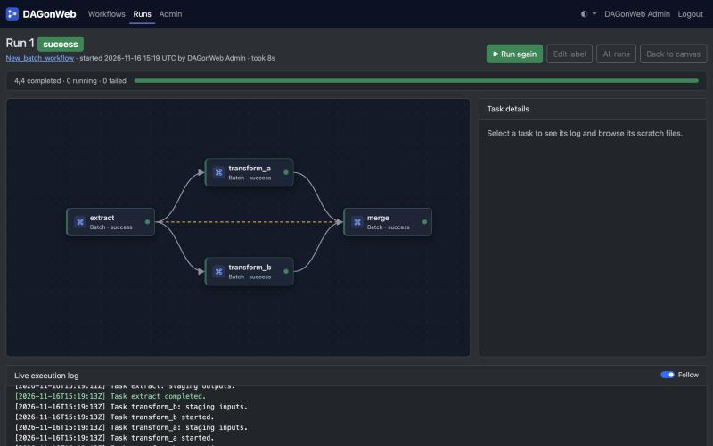
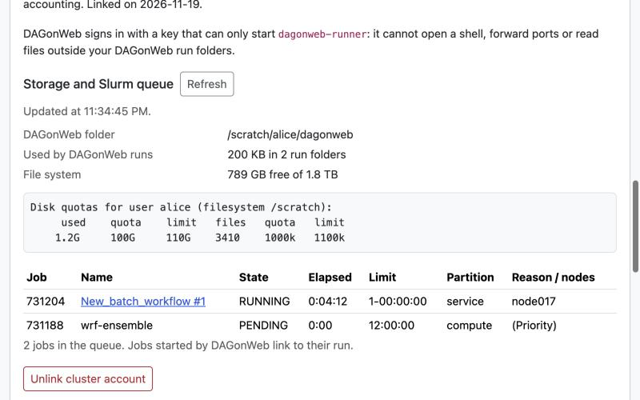
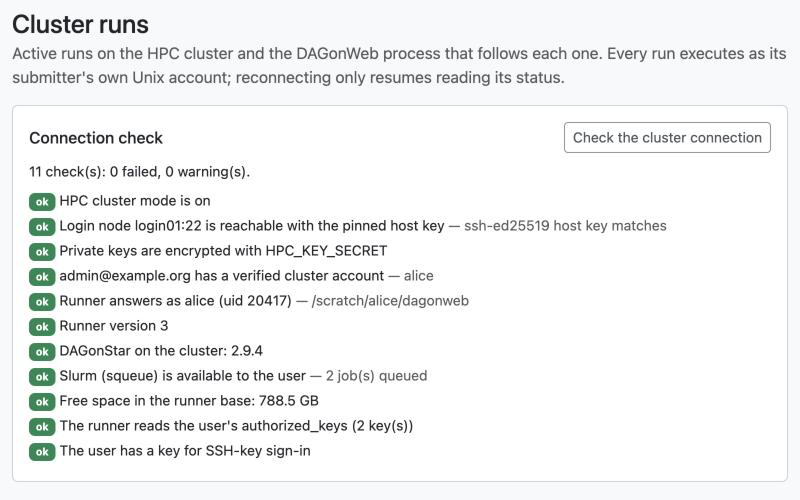
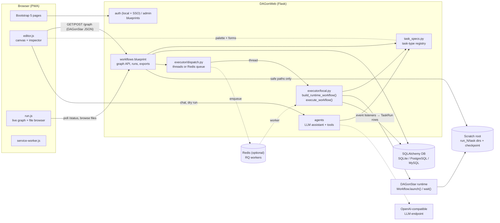
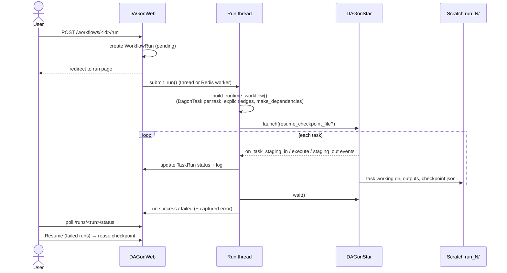
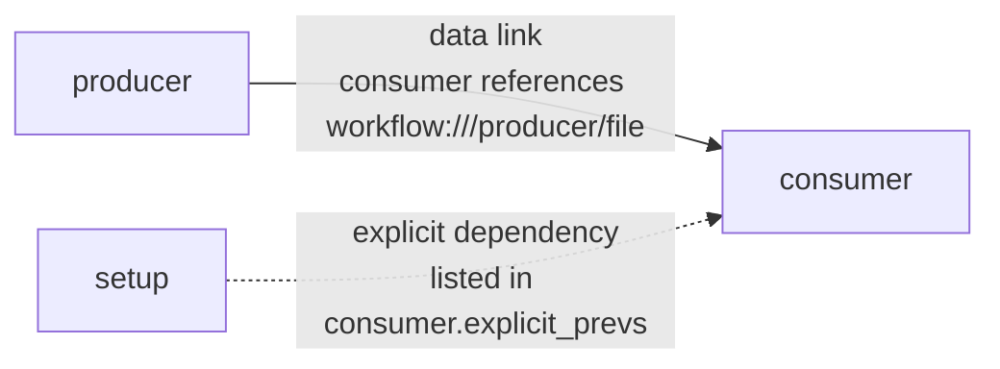
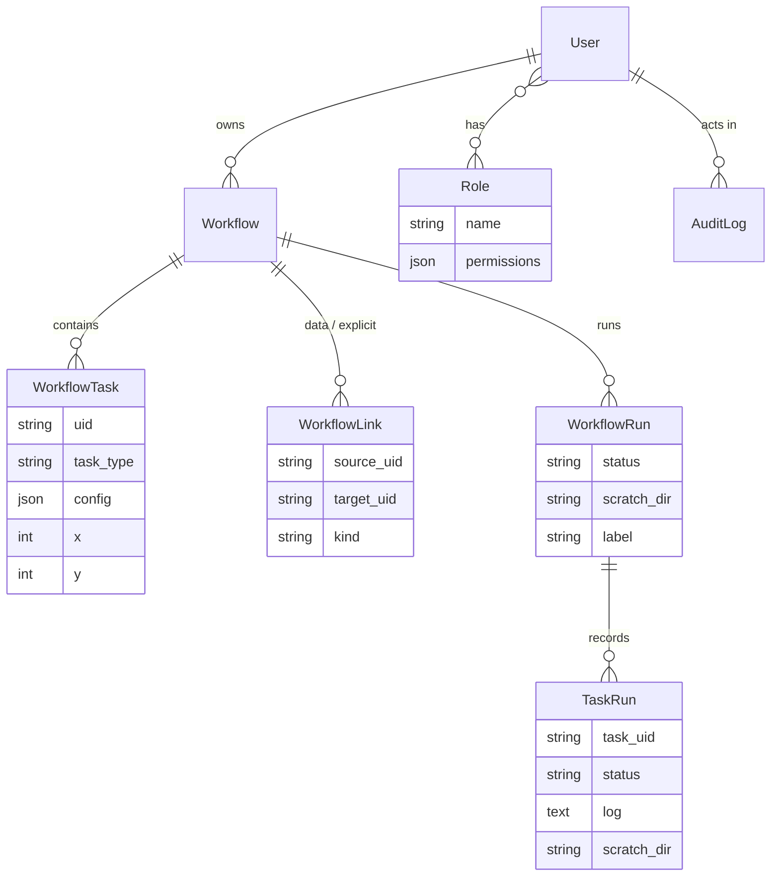

# DAGonWeb

DAGonWeb is a Flask/Bootstrap Progressive Web Application for designing, importing, exporting, and executing [DAGonStar](https://github.com/DagOnStar/dagonstar) workflows through a visual editor.

You draw a workflow on a canvas, DAGonWeb saves it as a standard DAGonStar task-map JSON document, and the DAGonStar runtime executes it on the server with `launch()` / `wait()`. Each run gets its own scratch directory, and you can browse and download every artifact from the browser.

The project targets **DAGonStar 3.0.0** (pinned in [requirements.txt](requirements.txt)).



## Highlights

- **All 16 DAGonStar task types, plus 5 DAGonWeb interactive types**:
  - Shell and HPC: Batch, Slurm, Checkpoint.
  - Containers: Docker, Kubernetes, Apptainer, Nomad.
  - Cloud, web and devices: Cloud, FaaS, Web, IoT.
  - Python and AI: Native, LLM, Agentic.
  - Volumes and meta-workflows: Volume (create or destroy an ad-hoc file-system volume) and Meta (run a Nextflow, Snakemake, Parsl, StreamFlow, CWL or command-line workflow unmodified, or the engine-free `mock` adapter) ([docs](docs/volumes_and_meta.md)).
  - DAGonWeb interactive: Upload, Form, Table, Chart, Download. They pause a run for files or form answers and show tables, charts and downloads on the run page, yet stay plain DAGonStar `batch` tasks in the document ([docs](docs/interactive_tasks.md)).
- **LLM workflow assistant.** An agent with tools designs, edits and dry-runs the workflow as a draft, from a plain-language description; you apply the draft to the canvas. It works with OpenAI and any OpenAI-compatible endpoint ([docs](docs/assistant.md)).
- **Generated from one registry.** The palette and the inspector forms come from [app/task_specs.py](app/task_specs.py), and so does the code that builds each runtime `DagonTask`.
- **Data links and explicit dependencies.**
  - A data link is a `workflow:///task/path` reference. DAGonStar infers the edge from it and stages the file.
  - An explicit dependency is stored in DAGonStar `explicit_prevs`. It orders tasks without moving any data.
  - A stream link is a reference with a `?stream` query (`workflow:///emit/numbers?stream=shared`). The consumer reads items while the producer still runs, through a shared ad-hoc volume. The canvas draws it as an animated dotted line.
- **Portable emulation.** With this option, container, scheduler, cloud and LLM tasks run their commands locally, so every template works on a laptop before you configure a real back-end.
- **Checkpoint resume.** Each run records a DAGonStar checkpoint file. **Resume** re-runs only the failed tasks and reuses the outputs that already completed.
- **Live run monitoring.**
  - The graph updates while the workflow runs, with a progress bar and the stage of each task (staging inputs, executing, staging outputs).
  - The error message of a failed task is captured and shown.
  - A file browser covers each task's scratch directory, with previews for text, JSON, CSV, GeoJSON and NetCDF.
- **Exports and imports** ([docs](docs/import_export.md)):
  - A ready-to-use **headless application ZIP**: a commented DAGonStar program, the JSON document, CWL, a sanitised `dagon.ini`, `requirements.txt` and `run.sh`.
  - A standalone Python program that runs with DAGonStar alone, supports `--resume`, `--input` and `--form`, and exits non-zero on failure.
  - DAGonWeb JSON, portable DAGonStar JSON, and CWL v1.2 (DAGonStar's `saveAsCWL`).
  - **Import** a JSON document, a DAGonStar Python program, or a ZIP application. Python is read by static analysis and never executed. The round trip is lossless: exporting an imported program gives back working, commented Python with its comments and layout.
- **Runtime options** per workflow: `max_threads`, `pre_stage` (stage inputs ahead of scheduling), `portable_emulation`, an optional FAIR provenance profile, and a guided `dagon.ini` editor.
- **Template gallery.** There is one runnable template per task type, plus a Meta template with an emulated Nextflow workflow. They are also exported as [examples/](examples).
- **Interface.**
  - Light, dark and automatic themes.
  - The Monaco editor for every multi-line text field, with syntax highlighting and context-aware completion: `workflow:///` references, shell `$inputs`, Python, JSON schemas from the task registry, and `dagon.ini` sections and keys ([docs](docs/text_editing.md)).
  - Keyboard shortcuts.
  - Debounced autosave with a status indicator.
  - Zoom and fit controls.
  - Layouts that work on phones.
  - Installable as a PWA, with a service worker scoped to the whole site.
- **Accounts, roles and permissions.**
  - Roles carry permissions (`workflows.create`, `workflows.run`, `workflows.publish`, `assistant.use`, `admin.access`); users manage only their own workflows and runs.
  - Local accounts with email-verified registration and domain restrictions, plus single sign-on with Google, Microsoft Entra ID (academic and work accounts) or any OpenID Connect provider.
  - Flask-WTF CSRF protection; file access is confined to the configured scratch root.
- **Administration panel** ([docs](docs/administration.md)): run statistics, audit log with CSV export, appearance (site name, tagline, logo, colors, default theme), authentication, execution back-end, scratch and retention, SMTP, and the LLM connector. Every setting can also be pinned with a `DAGONWEB_<KEY>` environment variable.
- **Try it without an account.** Visitors open any template in a guest playground and press **Dry run**: DAGonWeb checks the workflow and plays back how DAGonStar would execute it, stage by stage, without executing anything or storing it on the server ([docs](docs/playground.md)).
- **GDPR-ready.** Configurable privacy notice and cookie policy, a cookie banner with equal “Accept all” / “Necessary only” choices, consent at registration and on notice changes, self-service data export and account erasure, administrator tools for data requests, and retention clean-up ([docs](docs/privacy_gdpr.md)).
- **Accessible.** Built for WCAG 2.1 AA (EN 301 549): skip link, landmarks, keyboard alternatives to drag and drop, linked form errors, live status messages, contrast-checked themes and brand colors, reduced motion, chart data tables, and an accessibility statement ([docs](docs/accessibility.md)).
- **HPC clusters, as the user.** Installed on a login node, DAGonWeb runs every workflow as the submitter's own Unix account. Users link the account with a restricted key in `~/.ssh/authorized_keys`, and the key can only start `dagonweb-runner`. Nothing runs in the container, and nobody can run as someone else. Upload/Form input, results, ZIP archives and FAIR exports work as for local runs; the orchestrator can run as a Slurm job, runs are picked up again after a restart, users can sign in with a key from their own `authorized_keys` and see their storage and Slurm queue, administrators see every active cluster run, and `flask hpc-check` validates a site set-up end to end ([docs](docs/hpc.md)).
- **Scalable execution.** Runs execute in a bounded pool of threads, or, for many concurrent runs, on a **Redis queue** served by any number of workers ([docs](docs/deployment.md#redis-queue-for-many-concurrent-runs)).

## Screenshots

| Workflows and template gallery | Live run with artifact preview |
| --- | --- |
|  |  |

The dark theme follows the operating system, or you can choose it from the navbar menu:



On an HPC cluster ([docs](docs/hpc.md)), each user's account page shows their storage, quota and Slurm queue, and administrators can check the whole set-up from the browser:

| Cluster account: storage and Slurm queue | Administration: cluster connection check |
| --- | --- |
|  |  |

## Architecture



### Run lifecycle



### Workflow document

DAGonWeb stores and exchanges the **DAGonStar task-map document** unchanged. Editor state, such as task positions, form values, and runtime options, lives only in the additive `dagonweb` keys, so the file still loads with `dagon.Workflow.load_json`.

```json
{
  "name": "batch_example",
  "tasks": {
    "extract":     { "type": "batch", "command": "echo hello > data.txt", "prevs": [], "explicit_prevs": [] },
    "transform_a": { "type": "batch", "command": "data=workflow:///extract/data.txt ;\ntr a-z A-Z < $data > a.txt",
                     "prevs": ["extract"], "explicit_prevs": [],
                     "dagonweb": { "x": 400, "y": 120, "config": { "inputs": { "data": "workflow:///extract/data.txt" } } } }
  },
  "dagonweb": { "runtime": { "max_threads": 4, "portable_emulation": true } }
}
```

Dependencies are **always rebuilt** from the document:



On import, `prevs` and `nexts` are ignored. Edges come from `workflow:///` references and from `explicit_prevs`. A plain DAGonStar document that has no `explicit_prevs` key falls back to treating its legacy `prevs` as explicit edges, the same way DAGonStar does.

### Data model



## Task types

| Category | Type | Notes |
| --- | --- | --- |
| Shell & HPC | Batch | Shell script on the DAGonWeb host. Named inputs become shell variables. |
| | Slurm | `sbatch` job with partition, time, nodes/tasks, memory, extra sbatch options, and an optional job-local BeeOND volume. |
| | Checkpoint | Records producer outputs so a failed run can resume. |
| Containers & orchestrators | Docker, Kubernetes, Apptainer, Nomad | The command runs inside the image. Under portable emulation it runs locally instead. |
| Cloud, web & devices | Cloud | libcloud instance with a provider, flavour, SSH user and key options. |
| | FaaS | Function invocation. The default template uses DAGonStar's mock provider, so no credentials are needed. |
| | Web | HTTP(S) request saved to files. |
| | IoT | Bounded observation from a mock or a real IoT provider. |
| Python & AI | Native | Python callable with staged inputs. Its requirements are installed into a per-run virtual environment. |
| | LLM | OpenAI-compatible chat completion that uses `[llm.<name>]` profiles from `dagon.ini`. |
| | Agentic | Bounded agent contract with requirements and coverage checks. It uses `[agent.*]` and `[agent_provider.*]` profiles. |
| Volumes & meta-workflows | Volume | Creates an ad-hoc file-system volume (DAGonFS, Hercules, CAPIO, DynoStore or a registered provider; not BeeOND, which belongs to Slurm tasks) that other tasks share as `workflow:///<task>/<volume>/...`, or destroys it and stages results out. |
| | Meta | Runs a workflow written for Nextflow, Snakemake, Parsl, StreamFlow, a CWL runner or any command-line engine, as one task. The definition can be written inline. Under portable emulation the `mock` engine stands in for the real one. |
| DAGonWeb interactive | Upload, Form | Pause the run until a user uploads files or fills a form on the run page (headless: `--input` / `--form`). |
| | Table, Chart, Download | Turn CSV/JSON results into a table, a Chart.js chart (plus SVG), or download buttons. |

## Quick start with Docker

```bash
cp .env.example .env
docker compose up --build
```

Open http://localhost:8000 and sign in with the admin credentials from `.env` (without a `.env`, the demo defaults are `admin@example.org` / `admin12345`; change them before exposing the service).

The compose file mounts:

- `./instance` to `/app/instance`, for SQLite and `dagon.ini`.
- `./scratch` to `/scratch/dagonweb`, for run directories.

PostgreSQL and MySQL variants are in [docker-compose.postgres.yml](docker-compose.postgres.yml) and [docker-compose.mysql.yml](docker-compose.mysql.yml). For many concurrent runs, add the Redis overlay and scale the workers:

```bash
docker compose -f docker-compose.yml -f docker-compose.postgres.yml \
               -f docker-compose.redis.yml up --build --scale worker=4
```

See [docs/deployment.md](docs/deployment.md) for every combination. A prebuilt image is published to `ghcr.io/dagonstar/dagonweb`.

## Local development

```bash
python -m venv .venv
. .venv/bin/activate
pip install -r requirements-dev.txt   # runtime + pytest + fakeredis
flask --app wsgi db upgrade
flask --app wsgi seed
flask --app wsgi run --debug
```

Useful commands:

```bash
pytest                                   # full test suite, including end-to-end runs of every template
flask --app wsgi export-examples         # regenerate examples/*.json from the built-in templates
flask --app wsgi db migrate -m "change"  # create a migration after changing app/models.py
flask --app wsgi worker                  # Redis run worker (execution backend "redis")
flask --app wsgi cleanup-runs            # apply retention: runs, audit log, registration links
```

## Examples

[examples/](examples) contains one DAGonStar JSON document per built-in template. You can import any of them from **Workflows → Import**, or load them with DAGonStar directly. Templates for remote back-ends turn on `portable_emulation` in `dagonweb.runtime`, so they run locally until you configure the real service. The Agentic example also needs the `[agent.*]` / `[agent_provider.*]` profiles that the Agentic template writes into the workflow's `dagon.ini`.

## Documentation

- [Getting started](docs/getting_started.md)
- [User manual](docs/user_manual.md)
- [Workflow editor](docs/workflow_editor.md)
- [Interactive tasks](docs/interactive_tasks.md)
- [Volumes, streams and meta-tasks](docs/volumes_and_meta.md)
- [Workflow assistant](docs/assistant.md)
- [Import and export](docs/import_export.md)
- [Execution model](docs/execution_model.md)
- [Workflow API](docs/api.md)
- [Administration](docs/administration.md)
- [Guest playground](docs/playground.md)
- [Privacy and GDPR](docs/privacy_gdpr.md)
- [Accessibility](docs/accessibility.md)
- [Installation](docs/installation.md)
- [Configuration](docs/configuration.md)
- [Architecture](docs/architecture.md)
- [Security](docs/security.md)
- [Deployment](docs/deployment.md)
- [HPC cluster execution](docs/hpc.md)
- [Database examples](docs/database.md)

## Continuous integration

[.github/workflows/ci.yml](.github/workflows/ci.yml) runs on every push and pull request: the test suite on Python 3.12 and 3.13 (including end-to-end runs of every template, the Python round trip and the examples freshness check), JavaScript syntax checks, migrations on SQLite and PostgreSQL with `db check`, Compose validation, and a Docker build with a smoke test. [.github/workflows/docker-publish.yml](.github/workflows/docker-publish.yml) publishes multi-architecture images to GHCR from `main` and `v*` tags.

## License

Apache License, Version 2.0. See [LICENSE](LICENSE).
