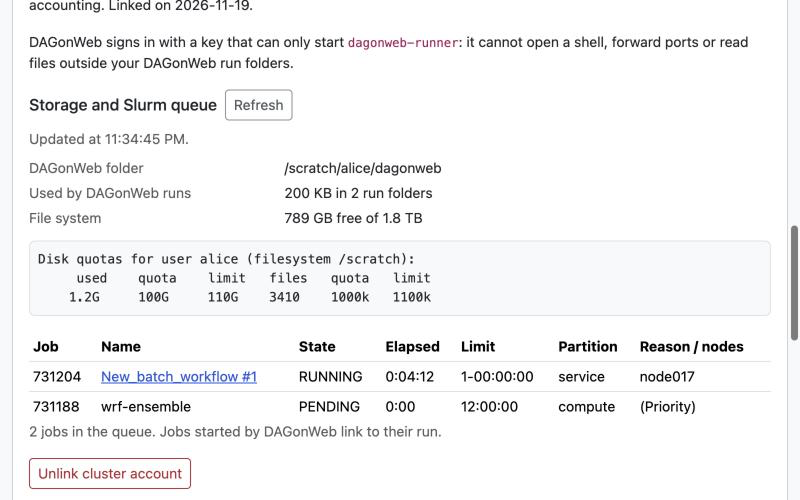
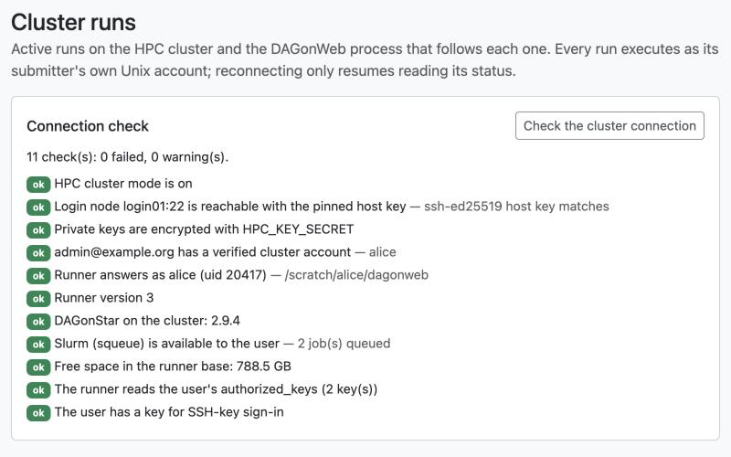
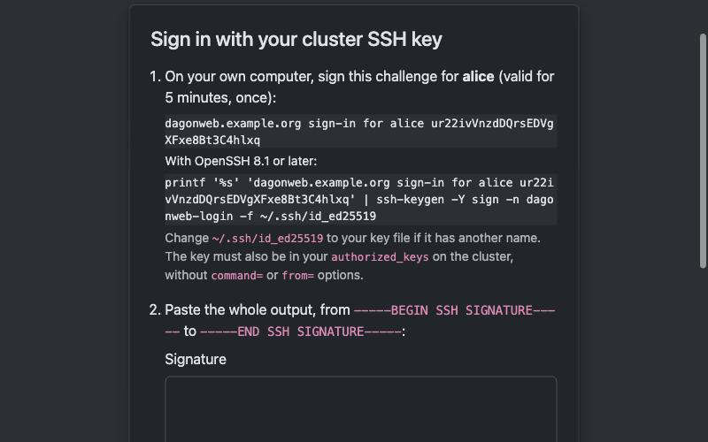

# Running on an HPC cluster as the users' own accounts

DAGonWeb can run on the login node of an HPC cluster with Docker Compose and execute every workflow **as the Unix account of the user who starts it**. Files, quotas, permissions and Slurm accounting all stay the user's own. The DAGonWeb container never gets root on the host. It has no Docker socket, no `/home` mount and no access to `/etc/shadow`, and it reaches the cluster only over SSH, through a single restricted program.

```
browser ─TLS─▶ DAGonWeb container ──ssh alice@login (forced command)──▶ dagonweb-runner (runs as alice)
                │  database, UI; no host privileges                     │ DAGonStar launch()/wait()
                ◀────────────── JSON events, status, files ─────────────┘ $SCRATCH/dagonweb/run_<id>
```

## How it works

1. **Linking an account.** On **Your account → Cluster account**, a user enters their cluster user name. DAGonWeb generates an Ed25519 key pair for that DAGonWeb account and shows one line to append to `~/.ssh/authorized_keys` on the cluster:

   ```
   restrict,from="172.16.0.0/12",command="/opt/dagonweb/bin/dagonweb-runner" ssh-ed25519 AAAA... dagonweb-account-42
   ```

   Only that Unix user can write their `authorized_keys`, so when DAGonWeb signs in with the key (**Verify cluster account**), it has proved that the DAGonWeb account controls the Unix account. DAGonWeb also checks that the runner reports the same user name and a uid of at least `hpc_min_uid`. A verified cluster account can be linked to only one DAGonWeb account.
2. **What the key allows.** `restrict` disables shells, PTYs and port, agent and X11 forwarding. `command=` makes sshd start `dagonweb-runner` whatever the client asks for, and `from=` limits the key to the DAGonWeb container's network. The runner accepts a fixed set of verbs (`ping`, `submit`, `status`, `cancel`, `ls`, `get`, `archive`, `put`, `keys`, `info`, `delete`). It never passes anything to a shell, and it touches files only below its base directory (`$SCRATCH/dagonweb`, otherwise `~/dagonweb`). `put` writes only below a run's `_dagonweb/data/` folder, `keys` only reads the user's `authorized_keys`, and `info` reports the user's storage, quota and Slurm jobs.
3. **Running.** When a user presses **Run**, DAGonWeb turns the workflow into a run specification. These are the same `DagonTask` arguments the local executor builds from `app/task_specs.py`. DAGonWeb sends the specification to `dagonweb-runner submit` as the submitter's own account. The runner starts DAGonStar detached, in `run_<id>/`, with the checkpoint in `run_<id>/_dagonweb/checkpoint.json`, and writes task events to a JSON-lines file. DAGonWeb polls `status` and updates the run page, the logs and the task states exactly as it does for local runs. Slurm tasks are submitted with `sbatch` as the user.

   With `hpc_orchestrator` set to `slurm`, the DAGonStar orchestrator itself runs as a small Slurm job (`sbatch --wrap`, with the options in `hpc_sbatch_options`) instead of a detached process on the login node. The run log shows the job id while the job waits in the queue, and **Cancel** calls `scancel`.
4. **Files.** The run page browses, previews and downloads task files through `ls` and `get`, and downloads a task folder as a ZIP through `archive`, limited to the run directory. Symbolic links that point outside it are refused. Table and Chart previews, Download links and FAIR exports (RO-Crate, PROV) work as for local runs: DAGonWeb reads them once, when the task or the run finishes, so the run page never waits for the cluster.
5. **Upload and Form tasks.** When a run waits for input, the run page shows the upload or form box to the submitter only. DAGonWeb writes the files with `put` into `run_<id>/_dagonweb/data/<task>/`, then a `.ready` marker, and the waiting task continues on the cluster.
6. **Resume.** A failed run resumes from its cluster checkpoint. Only its submitter can resume it.
7. **Web restarts.** The process that follows a run writes a heartbeat. If DAGonWeb restarts, the run keeps going on the cluster; the next time anyone opens the run page or the runs list, DAGonWeb sees the stale heartbeat, claims the run with one atomic update (so only one process follows it) and reconnects, reading the events it missed. To reconnect every active run at start-up, run `flask --app wsgi hpc-reattach`.

### Rules that keep it safe

- With `hpc_enabled` on, **nothing executes inside the DAGonWeb container**. Users must link an account before they can run anything, and the dispatcher refuses any run that has no cluster account.
- **A run always executes as the account of the person who starts it.** That holds for public workflows and for workflows owned by someone else. It also holds for administrators: they cannot run or resume anything as another user.
- Private keys are encrypted at rest with Fernet. The encryption key is `HPC_KEY_SECRET`, or a key derived from `SECRET_KEY` when it is unset. Private keys are never shown, exported or logged. Unlinking deletes the key.
- The login node's host key is pinned in the settings. DAGonWeb refuses unknown or changed host keys, so it will not send keys or workflows to an impostor.
- Linking, failed verifications, unlinking, SSH-key sign-ins and every run, together with its Unix account, are recorded in the audit log.
- Only the submitter can send Upload and Form input to a cluster run, even when an administrator can see the run.

## Set up

### On the login node (as root, once)

1. Install DAGonStar and the runner in a Python environment that users can read:

   ```bash
   python3 -m venv /opt/dagonweb/venv
   /opt/dagonweb/venv/bin/pip install "dagonstar[docker,kubernetes] @ git+https://github.com/DagOnStar/dagonstar.git@f62ceea7757ae313ce8d7fc6130896c9e7e83326"
   install -d -o root -g root -m 0755 /opt/dagonweb/bin
   install -o root -g root -m 0755 hpc/dagonweb_runner.py /opt/dagonweb/bin/dagonweb-runner
   sed -i '1s|.*|#!/opt/dagonweb/venv/bin/python -I|' /opt/dagonweb/bin/dagonweb-runner
   ```

2. Optionally, create `/etc/dagonweb/runner.json` (root-owned, mode 0644):

   ```json
   {"base": "$SCRATCH/dagonweb", "min_uid": 1000}
   ```

   `base` may use `~` and environment variables. `min_uid` makes the runner refuse system accounts, even if someone adds the key to one. Other keys:

   | Key | Meaning |
   | --- | --- |
   | `orchestrator` | `login` or `slurm`: forces the orchestrator mode whatever DAGonWeb asks for. |
   | `sbatch_options` | A list of `sbatch` options that replaces DAGonWeb's `hpc_sbatch_options`. |
   | `max_put_bytes` | Largest Upload file the runner accepts (default 1 GB). |
   | `authorized_keys_files` | Where `keys` reads public keys for SSH sign-in, with `%h` and `%u` as in sshd (default `~/.ssh/authorized_keys` and `~/.ssh/authorized_keys2`). Match your `AuthorizedKeysFile`. |
   | `quota_command` | A command, as a list, whose output the account page shows as the user's quota, with `%u` for the user name. For example `["lfs", "quota", "-h", "-u", "%u", "/scratch"]` or `["quota", "-s"]`. Not set: no quota report. |
   | `queue_command` | Replaces the default `squeue -h -u <user> -o "%i\|%j\|%T\|%M\|%l\|%P\|%R"`. It must print the same seven `\|`-separated fields. |

   The runner runs these commands as the user, without a shell, with a 20-second time limit.

3. Make sure sshd accepts public keys from the Docker network. Check `PubkeyAuthentication yes`, `AllowUsers` / `AllowGroups`, and any `Match Address` blocks. If the site uses `AuthorizedKeysFile` in a non-default location, tell users where to add the line.

4. Note the host key for the settings:

   ```bash
   cat /etc/ssh/ssh_host_ed25519_key.pub
   ```

### DAGonWeb (Docker Compose on the login node)

```bash
docker compose -f docker-compose.yml -f docker-compose.hpc.yml up --build -d
```

The overlay maps `host.docker.internal` to the host, so the container can reach the login node's sshd. It also requires `HPC_KEY_SECRET`. Put a Fernet key in `.env`:

```bash
python -c "from cryptography.fernet import Fernet; print(Fernet.generate_key().decode())"
```

Keep `HPC_KEY_SECRET` out of the database and back it up separately. Without it, the stored keys cannot be decrypted, and users have to link their accounts again.

Then open **Administration → HPC cluster**:

| Setting | Meaning |
| --- | --- |
| `hpc_enabled` | Run every workflow as the submitter's linked cluster account. |
| `hpc_ssh_host`, `hpc_ssh_port` | The login node as seen from the container (default `host.docker.internal:22`). |
| `hpc_ssh_host_key` | Required. The pinned public host key (one line, with or without a leading host name). |
| `hpc_runner_command` | The forced command written into the `authorized_keys` line. |
| `hpc_source_cidr` | The `from=` restriction, for example the Docker bridge network `172.16.0.0/12`. |
| `hpc_min_uid` | The lowest uid DAGonWeb accepts when verifying an account. |
| `hpc_poll_seconds` | How often run status is read from the cluster. |
| `hpc_orchestrator` | `login` (a detached process on the login node) or `slurm` (a small Slurm job per run). |
| `hpc_sbatch_options` | Long `sbatch` options for the orchestrator job, for example `--partition=service --time=48:00:00`. |
| `hpc_ssh_login_enabled` | Let users with a linked account sign in with a key from their own `authorized_keys` (see below). |

Every key can also be pinned with `DAGONWEB_<KEY>`, for example `DAGONWEB_HPC_ENABLED=true`.

### Users

1. Open **Your account → Cluster account**, enter your cluster user name and press **Create my DAGonWeb key**.
2. Sign in to the cluster as usual and append the line shown to `~/.ssh/authorized_keys`, all on one line.
3. Press **Verify cluster account**.

To revoke access at any time, delete the line from `authorized_keys`, or press **Unlink cluster account** in DAGonWeb (which deletes the key).

Once linked, the cluster account card also shows **Storage and Slurm queue**, read from the cluster when the page opens and on **Refresh**:

- the DAGonWeb folder on the cluster and how much space the user's runs take;
- the free space on that file system, and the site's quota report if `quota_command` is set;
- the user's own Slurm jobs, with links to the runs that DAGonWeb started.



## Checking a cluster set-up

After installing the runner, check the whole chain from the DAGonWeb container:

```bash
docker compose exec dagonweb flask --app wsgi hpc-check
docker compose exec dagonweb flask --app wsgi hpc-check --email alice@example.org --run
```

The first command checks that cluster mode is on, that the login node answers with the pinned host key, and that `HPC_KEY_SECRET` is set. With `--email`, it signs in as that user's linked account. It then checks the runner version, that the same DAGonStar version is installed on the cluster, Slurm, free space, and that the runner reads the same `authorized_keys` file as sshd. With `--run`, it also runs the Batch template on the cluster as that user, then deletes the workflow and its run folder (`--keep` keeps them). It exits with status 1 if a check fails.

**Administration → Cluster runs** runs the same checks with the administrator's own linked account, without a test run. The page also lists every active cluster run: who started it, the Unix account, the Slurm job, and whether a DAGonWeb process is following it. A run whose heartbeat is stale, for example after a restart, can be reconnected there one by one or all at once. Reconnecting only resumes reading the run's status, through its submitter's own account.



## Signing in with your own SSH key

With `hpc_ssh_login_enabled` on, the sign-in page offers **Sign in with your cluster SSH key** to users whose account is already linked:

1. Enter the cluster user name. DAGonWeb shows a one-time challenge that names the site and the account, valid for five minutes.
2. Sign it on your own computer with OpenSSH 8.1 or later:

   ```bash
   printf '%s' '<challenge>' | ssh-keygen -Y sign -n dagonweb-login -f ~/.ssh/id_ed25519
   ```

3. Paste the signature. DAGonWeb checks it (Ed25519, ECDSA, or RSA with SHA-2 and at least 2048 bits; SHA-1 `ssh-rsa` signatures and FIDO keys are refused), then asks the runner, as that cluster account, for its `authorized_keys`, and signs you in if the key is there.

The private key never leaves your computer. Keys limited with `command=`, `from=`, `principals=` or `cert-authority`, including DAGonWeb's own key, do not count. Each challenge can be used once, and every answer for an unknown or unlinked name is the same as for a wrong key, so names cannot be probed. Turn the setting off to go back to the site's usual sign-in.



## Testing

- `tests/test_hpc.py` simulates sshd. It accepts only a key whose public half was added to `authorized_keys`, then starts the real runner with `SSH_ORIGINAL_COMMAND` set. It covers linking, runs as the user, resume, file access and ZIP archives, path confinement, Upload and Form input, Table/Chart/Download results, FAIR exports, reconnecting after a restart, the Slurm orchestrator (with fake `sbatch`, `squeue` and `scancel`), SSH-key sign-in (signed with the real `ssh-keygen`), refusals and settings, the storage and queue report (with a fake `squeue` and a quota command), the administration page, and `hpc-check` including a test run.
- `tests/test_hpc_sshd.py` starts a real, unprivileged OpenSSH `sshd` on a free localhost port. It is skipped when OpenSSH is not installed. DAGonWeb links an account through paramiko, runs a workflow and reads its files. The OpenSSH client then checks, with the same key, that a shell, a PTY and forwarding are refused, that commands chained with `;` are refused, and that a wrong host key is rejected. Finally, `hpc-check --run` runs against the real sshd, and its host key probe must tell the right key from a wrong one.

## Current limits

- Downloads of a single file, and ZIP archives, are limited to 256 MB. Upload files are limited by the runner's `max_put_bytes`.
- With the `login` orchestrator, the DAGonStar orchestrator runs on the login node (detached, as the user). Use `slurm` on clusters that limit long-running processes there.
- A run whose follower stops (web restart, lost contact for a while) is picked up again when its page or the runs list is opened, or by `flask --app wsgi hpc-reattach`. Until then, its page shows the last state DAGonWeb read.
- In cluster mode, the merged `dagon.ini` (global and per-workflow) is written into the user's run folder, so keep no secrets in the global `dagon.ini` that users must not see.
- Account erasure asks the runner to delete the user's run folders. If the account is no longer reachable, the folders stay in the user's own cluster storage.
