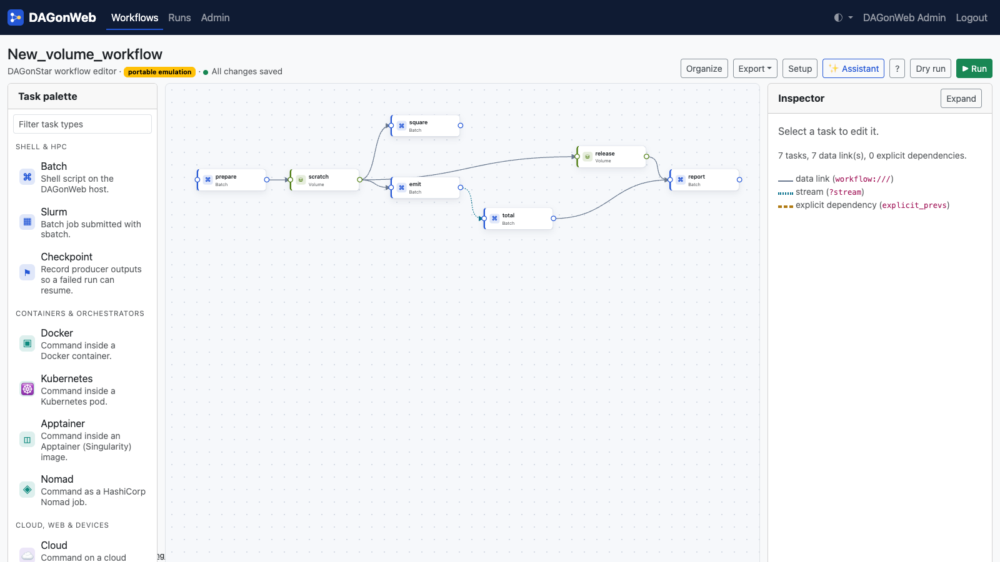
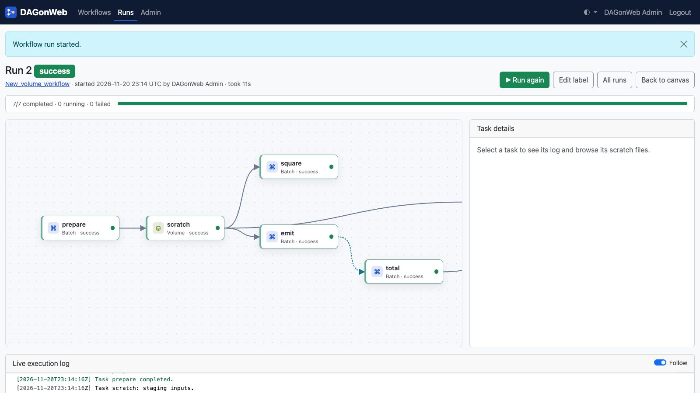
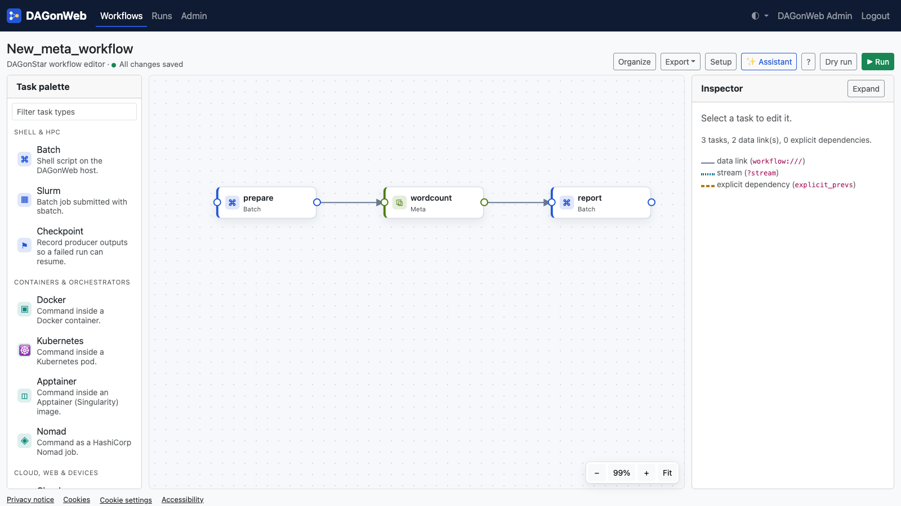

# Volumes, streams and meta-tasks

DAGonStar 3.0 added two task types and one kind of reference. DAGonWeb shows
them in the **Volumes & meta-workflows** group of the palette.

| Feature | DAGonStar | In DAGonWeb |
| --- | --- | --- |
| Volume task | `TaskType.VOLUME` | **Volume** palette item, with a create or a destroy action |
| Meta-task | `TaskType.META` | **Meta** palette item, with an optional inline workflow definition |
| Stream reference | `workflow:///<task>/<path>?stream[=<volume>]` | Typed in any command; drawn as an animated dotted link |
| Job-local BeeOND | `SlurmTask(beeond=...)` | **BeeOND volume** option of a Slurm task (advanced) |

All of them are saved in the plain DAGonStar document, so
`dagon.Workflow.load_json` reads the same workflow.

## Volume tasks

A Volume task with the **create** action starts one ad-hoc file-system volume
as a node of the graph. The providers are DAGonFS, Hercules, CAPIO and
DynoStore. BeeOND volumes exist only inside a Slurm allocation, so they are
set on Slurm tasks instead (see below).

| Field | Meaning |
| --- | --- |
| Action | `create` starts the volume. `destroy` copies results out and releases it. |
| Provider | Ad-hoc file system (create only). |
| Volume | Create: the volume name. Destroy: `workflow:///<create task>/<volume>`. |
| Stage in | Path in the volume → a `workflow:///task/path` reference, or `{"path": ..., "type": "file" \| "directory"}`. Each reference is a dependency. |
| Stage out | Destroy only. Path in the destroy task's directory → a path inside the volume. |
| Release | `auto` releases the volume when its last user finishes. `end` keeps it until a destroy task or the end of the run. |
| Export variable | Optional shell variable that carries the volume path in every task bound to it. |
| Provider options | Adapter options, such as `{"frontend": "fuse3"}`. Credential-like keys are refused. |

The Inspector shows only the fields of the selected action.



Other tasks use the volume through the ordinary schema. If the create task
`scratch` made the volume `shared`, then `workflow:///scratch/shared/results/squares.txt`
is `results/squares.txt` inside the volume. A command task that refers to it is
bound to the volume and reads and writes in place; nothing is copied, so
several tasks can share the same files. The destroy task depends on every task
that uses the volume. Later tasks read its staged-out copies as
`workflow:///<destroy task>/<path>`.

Preload providers (CAPIO, Hercules, DAGonFS `preload`) intercept the file
calls of programs, not the redirections of the launcher shell. Read and write
their volumes with a program (`cp`, `tee`, `python`), not with `>`.

## Streams

A stream lets a consumer process a producer's items while the producer is
still running. The consumer names the volume in the query of the reference:

```bash
# producer (emit)
for i in 1 2 3; do
  echo $i > item-$i
  "$DAGON_PYTHON" -m dagon.adhoc stream publish "$DAGON_STREAM_OUT" item-$i
done

# consumer (total)
for item in $("$DAGON_PYTHON" -m dagon.adhoc stream items workflow:///emit/numbers?stream=shared --into got); do
  total=$((total + $(cat "$item")))
done
```

The query is not part of the path. DAGonWeb links `emit` to `total` as a data
link and draws it as an animated dotted line, in the editor and on the run
page (the animation stops when the system asks for reduced motion).



Only command tasks (Batch, Slurm, containers, Cloud) can produce or consume streams.

## Meta-tasks

A Meta task runs a complete workflow written for another engine. DAGonStar
never modifies the engine: it writes the engine's own parameter files and runs
its documented command line.

| Field | Meaning |
| --- | --- |
| Engine | `command`, `nextflow`, `snakemake`, `parsl`, `streamflow` or `cwl`. |
| Workflow definition | A file name (with an inline source), a path on the execution host, or an engine-resolved name such as `nextflow-io/hello`. |
| Workflow source | Optional. DAGonWeb writes it as the definition file. The editor highlights it from the file extension. |
| Inputs | Name → value. A `workflow:///` string is staged (file or directory) and passed to the engine as an absolute path. |
| Outputs | Name → path, or `{"path", "source", "type"}`. They are collected below `outputs/`. |
| Engine options | Adapter options, for example `{"profile": "standard"}` for Nextflow or `{"cores": 2}` for Snakemake. The `command` engine needs an argument vector with `{python}`, `{workflow}` and `{parameters_file}` placeholders. |
| Timeout, Input staging, Environment | Advanced options. Never put credentials in the environment: engines inherit them from the process. |

Downstream tasks read the outputs as `workflow:///<meta task>/outputs/<path>`.



An inline source is written to `<run>/_dagonweb/meta_workflows/<task>/<file>`.
The document stores only the relative path `meta_workflows/<task>/<file>`; the
source itself stays in the DAGonWeb extension. The generated Python program
embeds the sources in `META_SOURCES` and writes them below its working
directory. Cluster runs write them below the run folder in the same way.

Under portable emulation DAGonStar uses its mock engine, which writes one JSON
placeholder per declared output. Site defaults for an engine executable go in
a `[meta.<engine>]` section of `dagon.ini` (`executable`, and `python` for
Parsl).

## BeeOND on Slurm tasks

The **BeeOND volume (JSON)** option of a Slurm task accepts `true` or `"task"`
for a per-task volume, or an object of BeeOND options. The job reaches the
volume as `$DAGON_BEEOND`.

## Templates

- **Volume** (`examples/volume.json`): `prepare → scratch` (create the
  `shared` DAGonFS volume) → `square` and `emit` write and read in the volume,
  `emit` streams numbers to `total`, `release` (destroy) stages `results/`
  out, and `report` reads the copies. It starts in portable emulation, so it
  runs without DAGonFS.
- **Meta** (`examples/meta.json`): `prepare → wordcount → report`. The
  `wordcount` task runs an inline Python stand-in engine through the `command`
  adapter, so it runs without Nextflow or Snakemake.

## Not in the document

DAGonStar does not serialize workflow-scope and task-scope ad-hoc file systems
(`Workflow.create_adhoc_filesystem`, `Task.create_adhoc_filesystem`) into JSON.
DAGonWeb therefore offers ad-hoc storage through Volume tasks and the Slurm
BeeOND option, which are part of the document.
